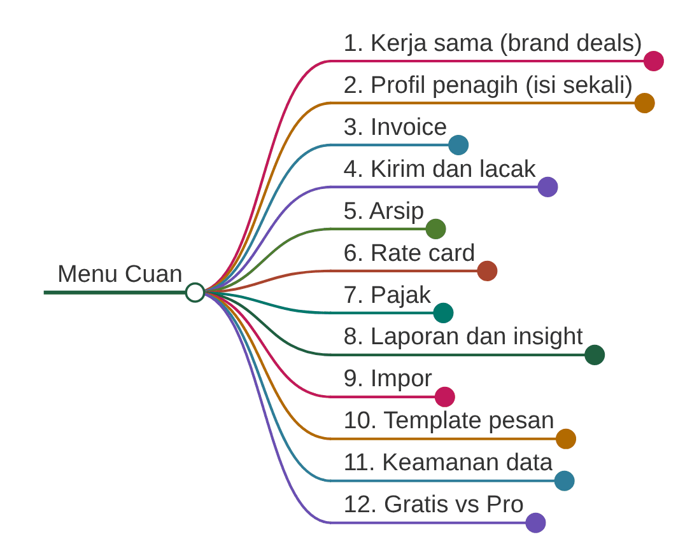

# Menu Cuan: kerja sama, invoice, rate card

Versi 0.1 · draf untuk didiskusikan

## Mind map



Detail: [bagian 1](mindmap/cuan-bagian-1.png) (kerja sama, profil penagih,
invoice, kirim, arsip) · [bagian 2](mindmap/cuan-bagian-2.png) (rate card,
pajak, laporan, impor, template, keamanan, paket). Sumber teks:
[mindmap/menu-cuan.md](mindmap/menu-cuan.md).

## 1. Kerja sama (brand deals)

Ini pengganti tabel "Brand Deals 2026" di Notion. Kolom yang sudah ada
dipertahankan, dengan tiga perbaikan yang terlihat dari datamu sekarang.

| Kolom di Notion | Di aplikasi | Catatan |
|---|---|---|
| BRAND | Brand | Brand jadi data sendiri (alamat, PIC, email), jadi tidak perlu diketik ulang setiap invoice |
| Status Konten | Status konten | Nego → Deal → Draft → Revisi → Approved → Posted |
| Tgl Post | Tanggal posting | Tersambung ke menu Tugas |
| Status Pay | Status bayar | Belum → Ditagih → DP → Lunas, ditambah Telat (otomatis kalau lewat jatuh tempo) |
| Tgl Pay | Tanggal dibayar | Diisi saat ditandai Lunas |
| FEE | Fee | Bruto, sebelum potongan |
| Platfrom | **Platform + Format + Add-on** | Sekarang isinya campuran (REELS, TIKTOK, MIRRORING, Owning, Carousel). Dipecah supaya bisa dihitung: Platform = IG/TikTok/YouTube, Format = Reels/Carousel/Story/Video, Add-on = Collab/Mirroring/Owning/Link |
| Akun | Akun | @tipscareer, @tipsngonten, dst. Setiap akun punya rate card sendiri |
| SOW | SOW | Ditulis sebagai daftar deliverable. Tiap baris otomatis jadi tugas di menu Tugas dan baris di invoice |
| — | **Lewat (perantara)** | Brand yang ditulis "(Jenni)" dicatat sebagai deal lewat Jenni, beserta komisinya, sehingga fee bersihmu terlihat |
| — | Termin | DP sekian %, pelunasan setelah posting |
| — | Bukti tayang | Link postingan + angka dari data impor |
| — | Brief & kontrak | File atau link |

## 2. Profil penagih (diisi sekali, dipakai di semua invoice)

- Nama sesuai KTP/rekening, alamat, email, no HP/WA.
- **NIK** dan **NPWP.** Sejak 2024 NIK berfungsi sebagai NPWP orang pribadi.
  Kolom NPWP otomatis terisi dari NIK, tapi tetap bisa diubah.
- Status PKP (kalau ya, invoice menambahkan PPN).
- **Rekening:** bank, nomor, atas nama. Bisa lebih dari satu, dengan satu
  rekening sebagai default.
- **Tanda tangan:** digambar langsung di layar atau upload PNG transparan.
- Logo (opsional).
- Format nomor invoice, misalnya `INV/TC/2026/11/001`.

## 3. Invoice

Dibuat dari satu baris kerja sama. Semua kolom terisi otomatis, lalu tinggal
dicek.

| Bagian | Isi |
|---|---|
| Kepala | Logo, nama, kontak, NPWP; nomor invoice, tanggal, jatuh tempo (NET 7/14/30), no PO kalau brand minta |
| Bill to | Nama PT/brand, alamat, PIC, email (dari data brand) |
| Tabel | Deskripsi (dari SOW), qty, harga satuan, jumlah |
| Hitungan | Subtotal → diskon → PPN (kalau PKP) → total tagihan → dikurangi DP yang sudah dibayar → **sisa tagihan** |
| Info potongan | Perkiraan PPh 21 yang dipotong brand dan **perkiraan uang bersih diterima**. Ditampilkan di aplikasi, tidak wajib dicetak di invoice |
| Terbilang | "Satu juta dua ratus ribu rupiah" (sering diminta tim finance) |
| Pembayaran | Bank, nomor rekening, atas nama |
| Penutup | Catatan/syarat, tanda tangan, nama terang, kota & tanggal |
| Meterai | Pengingat kalau nilai lebih dari Rp5.000.000 |

**Perkiraan PPh 21:** untuk kreator perorangan, brand umumnya memotong
50% × penghasilan bruto × tarif Pasal 17 (lapisan pertama 5%), jadi sekitar
2,5% dari fee. Rumus dan tarifnya bisa diubah di pengaturan, karena aturan
pajak bisa berubah. Ini perkiraan, bukan konsultasi pajak.

### Setelah dibuat

- Unduh PDF, bagikan link invoice, atau kirim lewat email/WA dengan template pesan.
- Status: Draft → Terkirim → Lunas, ditambah Telat dan Batal.
- Pengingat H-1 dan saat jatuh tempo, plus template pesan follow-up.
- **Kwitansi otomatis** begitu ditandai Lunas.
- Setelah terkirim, invoice dikunci. Perubahan dibuat sebagai revisi
  (`INV/TC/2026/11/001-R1`), supaya arsipnya rapi.

### Arsip

Semua invoice dan kwitansi tersimpan. Bisa dicari dan difilter (brand,
akun, tahun, status), diunduh ulang, diduplikat untuk brand yang sama, dan
diekspor ke CSV/Excel untuk akuntan.

## 4. Rate card otomatis

### Rumus

```
rate = median views ÷ 1.000 × tarif per 1.000 views
       × faktor engagement × faktor format
       + add-on − diskon paket
       → dibulatkan ke Rp50.000 terdekat
```

| Komponen | Sumber / default (bisa diubah) |
|---|---|
| Median views | Data impor 30 atau 90 hari terakhir, per akun dan platform |
| Tarif per 1.000 views | Isi sendiri, **atau dihitung dari deal lamamu**: fee dibagi views postingan deal itu. Contoh: fee Rp1.200.000 untuk postingan dengan 60.000 views berarti Rp20.000 per 1.000 views |
| Faktor engagement | ER kamu ÷ ER patokan, dibatasi 0,8 sampai 1,5 |
| Faktor format | Reels/TikTok 1,0 · Carousel 0,7 · Story 0,3 · YouTube 2,0 |
| Add-on | Collab +20% · link in bio/IGS tap link +Rp150.000 · mirroring +40% · owning/hak pakai +30% per bulan · eksklusif kategori +25% · ads/Spark code +50% per bulan · rush (< 3 hari) +30% · raw footage +20% · revisi tambahan +Rp100.000 |
| Diskon paket | 3 konten −10%, bulanan −15% |

Hasilnya dua angka: **harga buka** (untuk nego) dan **harga minimum** (batas
bawah). Di sebelahnya ada **fee rata-rata asli** dari deal-deal sebelumnya,
misalnya "Reels @tipscareer: rata-rata Rp1.150.000 dari 6 deal", supaya
kelihatan kalau rate card terlalu tinggi atau terlalu rendah.

### Template rate card

Satu rate card per akun. Isinya:
- harga per format;
- paket (single, bundle 3 konten, bulanan);
- add-on;
- syarat standar: DP, jumlah revisi, durasi hak pakai, waktu pengerjaan.

Bisa dibagikan sebagai PDF atau link, dan nyambung ke media kit.

## 5. Ide tambahan (selain invoice dan rate card)

| Ide | Kenapa penting |
|---|---|
| **Impor dari Notion** (CSV) | Data "Brand Deals 2026" langsung pindah, tanpa ketik ulang. Kolom Platfrom otomatis dipecah jadi platform, format, dan add-on |
| **Perantara + komisi** | Fee bruto vs yang benar-benar kamu terima kelihatan jelas |
| **Termin / DP** | Banyak brand bayar DP dulu; sisa tagihan dihitung otomatis |
| **Lama dibayar per brand** | Kelihatan brand yang selalu telat bayar, berguna untuk menentukan syarat DP berikutnya |
| **Brand langganan** | Brand yang deal lebih dari sekali bisa ditawari paket bulanan |
| **Uang masuk bulan depan** | Total invoice yang belum dibayar plus jadwal posting yang sudah deal |
| **Rekap pajak tahunan** | Total bruto, perkiraan PPh 21, dan bukti potong per brand, siap untuk SPT |
| **Template pesan** | Balas DM dengan rate card, kirim invoice, follow-up bayar, kirim bukti tayang |
| **Pipeline nego** | Catat tawaran yang masuk dan yang ditolak; lihat rasio deal dan selisih harga tawar vs rate card |
| **Mata uang asing** | Untuk brand luar: USD, SWIFT code, alamat bank |

## 6. Keamanan data sensitif

NIK, NPWP, nomor rekening, dan tanda tangan termasuk data pribadi yang
sensitif.
- Dienkripsi di database.
- Tampil tersamar di layar (`•••• 1234`), dibuka hanya saat perlu.
- Tidak ikut di link invoice publik kecuali dipilih (rekening biasanya perlu,
  NIK tidak).
- Ikut terunduh di "Unduh semua data" dan ikut terhapus saat hapus akun.

Detail syarat ada di [akun-privasi.md](akun-privasi.md).

## 7. Paket

| | Gratis | Pro |
|---|---|---|
| Kerja sama | Tanpa batas | Tanpa batas |
| Invoice | 3 per bulan | Tanpa batas, plus kwitansi, link, pengingat |
| Rate card otomatis | — | Ya |
| Rekap pajak & ekspor | — | Ya |
| Impor Notion | Ya (sekali, supaya mudah pindah) | Ya |

## 8. Keputusan terbuka

1. Perkiraan PPh 21 dicetak di invoice, atau cukup ditampilkan di aplikasi? (Usulan: di aplikasi saja.)
2. Default jatuh tempo: NET 7 atau NET 14?
3. Nilai awal add-on dan faktor format: pakai angka di atas, atau kamu punya patokan sendiri?
4. Perlu contoh file ekspor CSV dari Notion "Brand Deals 2026" supaya impornya pas.
