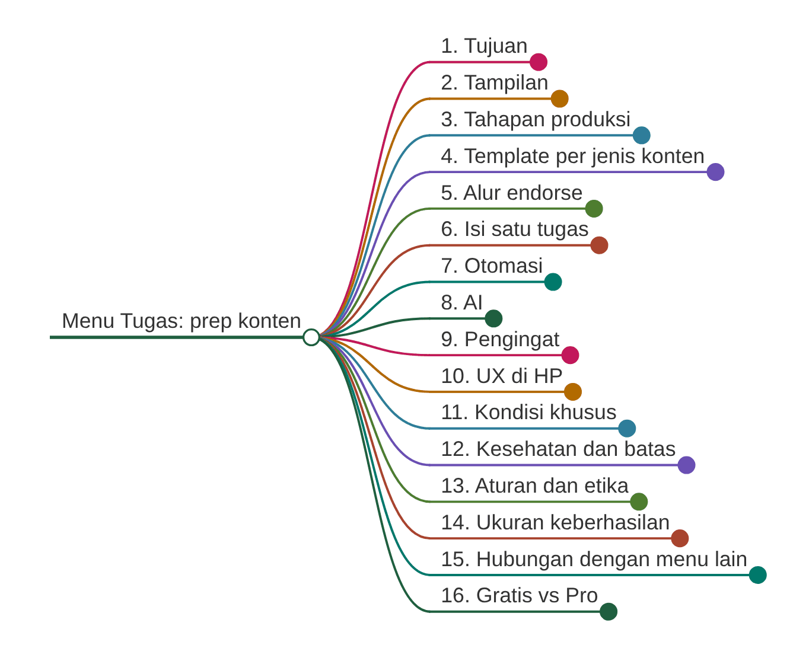

# Menu Tugas: persiapan konten

Versi 0.1 · draf untuk didiskusikan

Menu ini menjawab satu pertanyaan: **"hari ini aku harus ngapain supaya
konten berikutnya terbit tepat waktu?"** Ia mengurus semua langkah dari ide
sampai evaluasi, termasuk alur kerja sama dengan brand (endorse).

## Mind map

Gambaran besar:



Detail, dibagi tiga supaya terbaca:

- [Bagian 1: tujuan, tampilan, tahapan produksi](mindmap/bagian-1.png)
- [Bagian 2: template, alur endorse, isi tugas, otomasi, AI, pengingat](mindmap/bagian-2.png)
- [Bagian 3: UX di HP, kondisi khusus, kesehatan, aturan, ukuran, paket](mindmap/bagian-3.png)

Sumber teksnya ada di [mindmap/menu-tugas.md](mindmap/menu-tugas.md).
Berkas ini bisa dibuka sebagai mind map interaktif lewat
[markmap](https://markmap.js.org/repl).

## 1. Posisi di IA (usulan)

Dengan menu Tugas, peran tiap menu jadi lebih tegas:

| Menu | Isinya | Pertanyaan |
|---|---|---|
| Ringkasan | Performa lintas platform | "Minggu ini gimana?" |
| **Tugas** | Produksi: hari ini, papan, kalender, template | "Hari ini ngapain?" |
| Ide | Bank ide, saran AI, hashtag dipantau | "Mau bikin apa?" |
| Postingan | Analitik per postingan (sebelumnya Konten → Postingan) | "Konten mana yang laku?" |
| Cuan | Komisi, endorse, invoice, rate card, media kit | "Dapat berapa?" |
| Laporan | Laporan mingguan, laporan klien | "Apa yang harus dilaporkan?" |

Bar bawah HP: **Ringkasan · Tugas · (+) · Cuan · Lainnya**.
Tombol (+) berisi: Tugas baru, Ide baru, Impor screenshot, Impor file.

## 2. Tiga objek utama

```
Template ──(dipakai untuk membuat)──► Konten ──(punya banyak)──► Tugas ──(punya)──► Checklist
                                         │
                                         └──(setelah terbit, dihubungkan ke)──► Postingan (hasil impor)
```

- **Konten**: satu rencana konten. Contohnya "Review sunscreen untuk kulit
  berminyak, TikTok + Reels, terbit Jumat 19.00".
- **Tugas**: satu langkah kerja dengan tenggat. Contohnya "Rekam A-roll",
  Rabu 10.00, 60 menit. Tugas juga bisa berdiri sendiri tanpa konten
  (misalnya "Beli lampu ring").
- **Template**: kumpulan tugas dengan jarak hari relatif terhadap tanggal
  posting.
- **Postingan**: data hasil impor. Begitu cocok dengan konten yang sudah
  Terbit, hasilnya muncul di kartu konten.

## 3. Tahapan

| Mode lengkap (9) | Mode simpel (4) |
|---|---|
| Ide & riset | Rencana |
| Brief | Rencana |
| Naskah | Rencana |
| Pra-produksi | Rekam |
| Rekam | Rekam |
| Edit | Edit |
| Siap terbit | Edit |
| Terbit | Terbit |
| Evaluasi | Terbit |

Mode simpel adalah default untuk pengguna baru. Mode lengkap bisa
dinyalakan di Pengaturan atau per template.

## 4. Template jadwal mundur (contoh bawaan)

Pengguna cukup memilih template dan tanggal posting. Semua tugas langsung
dibuat dengan tenggatnya masing-masing. Kalau tanggal posting digeser, semua
tugas ikut bergeser.

**Video pendek (TikTok / Reels / Shorts)**

| Kapan | Tugas | Estimasi |
|---|---|---|
| H-4 | Brief + 3 opsi hook | 20 menit |
| H-3 | Naskah + draft caption | 30 menit |
| H-3 | Siapkan alat, properti, outfit | 15 menit |
| H-2 | Rekam A-roll + B-roll | 60 menit |
| H-1 | Edit, subtitle, cover | 90 menit |
| H | Posting di jam terbaik + pin komentar | 10 menit |
| H | Balas komentar di jam pertama | 30 menit |
| H+1 | Cek angka 24 jam | 5 menit |
| H+7 | Evaluasi + "buat lagi?" | 10 menit |

**Endorse**

| Kapan | Tugas |
|---|---|
| H-14 | Catat brief, deliverable, rate, revisi, hak pakai |
| H-12 | Konfirmasi produk dikirim (status Menunggu sampai datang) |
| H-10 | Draft naskah → kirim ke brand |
| H-8 | Revisi naskah, approval |
| H-6 | Rekam |
| H-4 | Edit → kirim draft video |
| H-2 | Revisi final, approval |
| H | Posting dengan label kolaborasi berbayar |
| H+1 | Kirim bukti tayang |
| H+7 | Kirim insight 7 hari + invoice (masuk ke Cuan) |

**Live jualan**

| Kapan | Tugas |
|---|---|
| H-3 | Pilih produk, cek stok dan komisi |
| H-2 | Susun rundown dan promo |
| H-1 | Umumkan jadwal live di story |
| H | Cek internet, lampu, HP kedua untuk baca komentar |
| H, 1 jam sebelum | Pengingat di story |
| H+1 | Rekap penjualan dan komisi |

Template lain: carousel, foto feed, story harian (berulang), YouTube
panjang, affiliate, kolaborasi, konten berseri, serta template buatan
sendiri.

## 5. Layar utama di HP

**Hari ini**

```
┌────────────────────────────────┐
│ Selasa, 26 Nov       ▢▢▢▢▢ 4/7 │  ← progres hari ini
│ ⚠ Terlambat (1)                │
│ ○ Edit "Sunscreen" · 90m  [>]  │
│ Hari ini (3)                   │
│ ○ Rekam "OOTD kampus" · 60m    │
│ ○ Kirim draft ke @brand ·Endrs │
│ ● Posting 19.00 "Hair oil" ✓   │
│ Besok (2)                      │
│ ...                            │
│                                │
│ [Ringkasan][Tugas][+][Cuan][⋯] │
└────────────────────────────────┘
```

Geser kanan untuk selesai, geser kiri untuk menunda ke besok atau memilih
tanggal.

**Mode syuting**: layar penuh, layar tetap menyala, daftar shot dengan
centang besar, teleprompter dari naskah (kecepatan bisa diatur), catatan
take terbaik, dan tombol "Selesai rekam". Selesai rekam memindahkan konten
ke tahap Edit.

## 6. Model data tambahan

| Entitas | Isi utama |
|---|---|
| Konten | brand, judul, jenis, platform utama, platform turunan, tahap, tanggal & jam posting, tujuan, pilar, link referensi, naskah, caption, kerja sama terkait, postingan terkait |
| Tugas | konten (opsional), judul, tahap, tenggat (tanggal + jam), estimasi, waktu aktual, prioritas, status, menunggu (brand/produk/editor), berulang, penanggung jawab, catatan |
| ItemChecklist | tugas, teks, selesai, urutan |
| Shot | konten, deskripsi, jenis (A-roll/B-roll), lokasi, selesai, catatan take |
| Template | nama, jenis konten, mode (simpel/lengkap), daftar langkah {judul, tahap, offset hari, jam, estimasi, checklist} |
| Lampiran | konten/tugas, jenis (link, gambar, file di Drive), URL |

Status tugas: **Belum · Dikerjakan · Menunggu · Selesai · Batal**.
Konten yang batal dikembalikan ke Bank ide, bukan dihapus.

## 7. Aturan yang dibangun ke dalam produk

- Checklist **QC** di tahap Edit dan **Terbit** untuk konten endorse otomatis
  berisi: label kolaborasi berbayar, tag brand, cek hak cipta musik.
- **Kapasitas mingguan**: pengguna mengisi berapa konten yang realistis per
  minggu. Aplikasi memberi peringatan kalau jadwal melebihi kapasitas atau
  menabrak hari libur.
- File video **tidak disimpan** di server kita, hanya link (misalnya Google
  Drive). Biaya tetap rendah, dan data mentah tetap milik pengguna.

## 8. Ukuran keberhasilan menu ini

- ≥ 70% konten terbit tepat waktu (di antara pengguna aktif).
- Rata-rata waktu dari ide sampai terbit turun dari bulan ke bulan.
- ≥ 50% pengguna aktif membuka "Hari ini" minimal 3 hari per minggu.
- Tahap yang paling sering macet terlihat di Laporan.

## 9. Keputusan terbuka

1. Menu **Tugas** terpisah dari **Postingan** (usulan di atas), atau tetap
   satu menu "Konten" dengan tab?
2. Default **mode simpel** untuk pengguna baru: setuju?
3. Mode syuting dengan teleprompter masuk versi pertama, atau menyusul?
4. Fase tim (editor/talent dengan akun sendiri): perlu disiapkan sejak awal
   di model data? (Usulan: ya, tapi UI-nya menyusul.)
