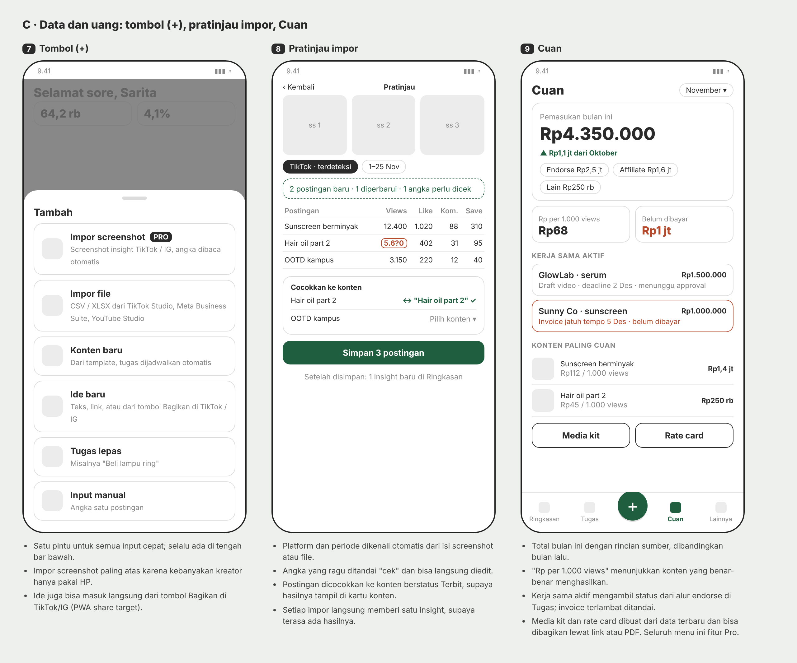

# Wireframe HP (v0.1)

Low-fidelity, 9 layar. Sumber: [index.html](index.html), buka di browser.

Asumsi yang dipakai (belum diputuskan final):
- **Tugas** jadi menu sendiri; bar bawah HP: Ringkasan · Tugas · (+) · Cuan · Lainnya.
- Pengguna baru memakai **mode simpel** (Rencana → Rekam → Edit → Terbit).
- **Mode syuting** masuk versi pertama; teleprompter fitur Pro.

| Gambar | Layar |
|---|---|
|  | 1 Ringkasan · 2 Tugas, Hari ini · 3 Tugas, Papan |
|  | 4 Detail konten · 5 Konten baru dari template · 6 Mode syuting |
|  | 7 Tombol (+) · 8 Pratinjau impor · 9 Cuan |

Belum ada: versi desktop, onboarding, Ide, Postingan, Laporan, Pengaturan,
dan tampilan kosong (data belum ada).
