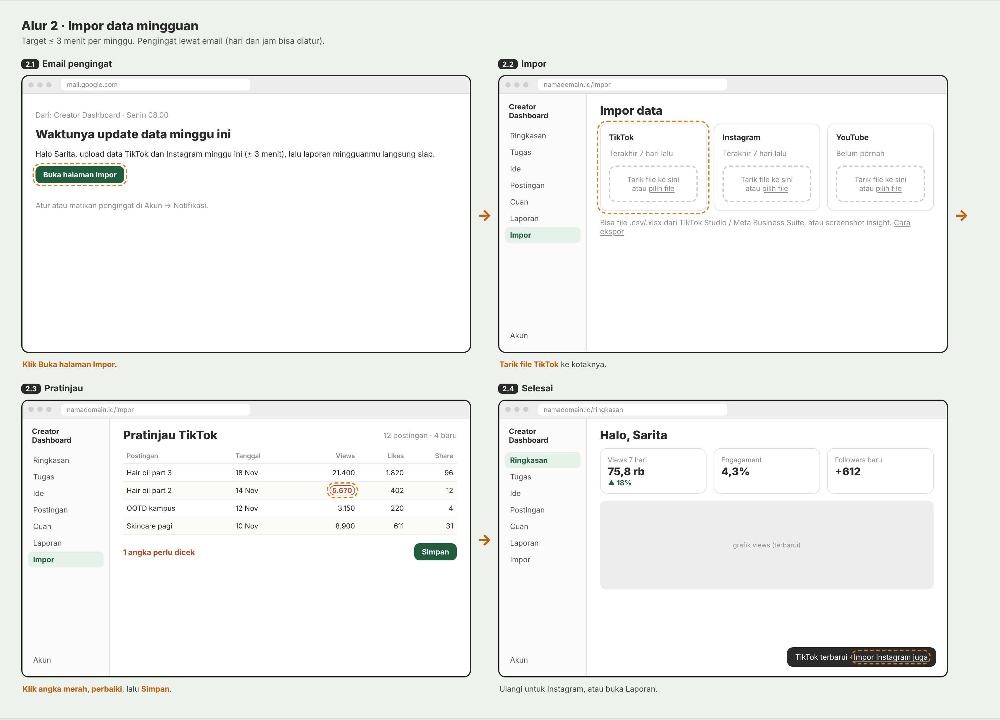
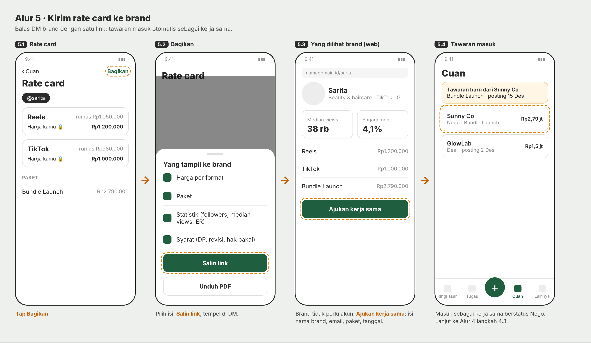
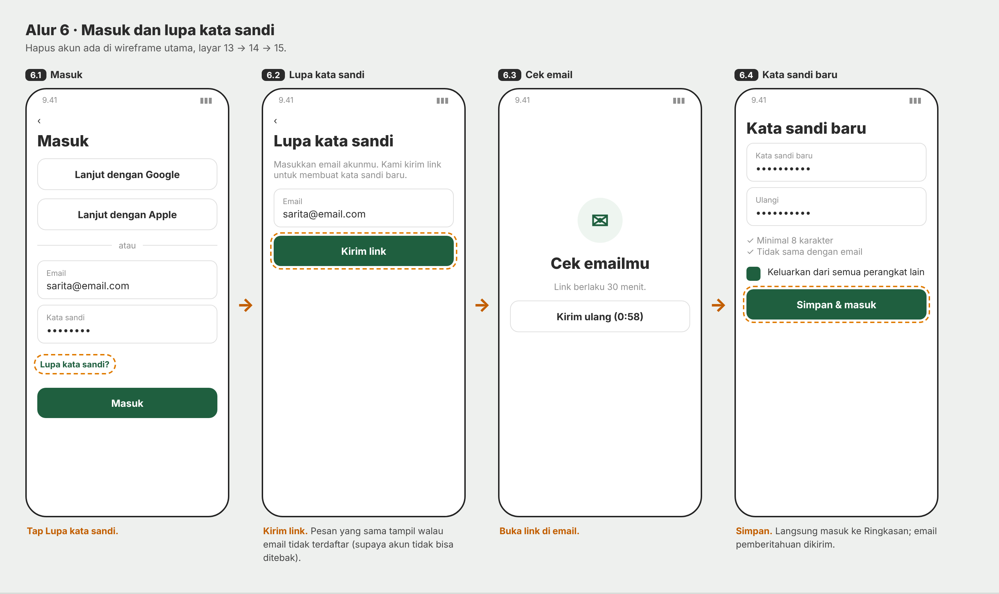
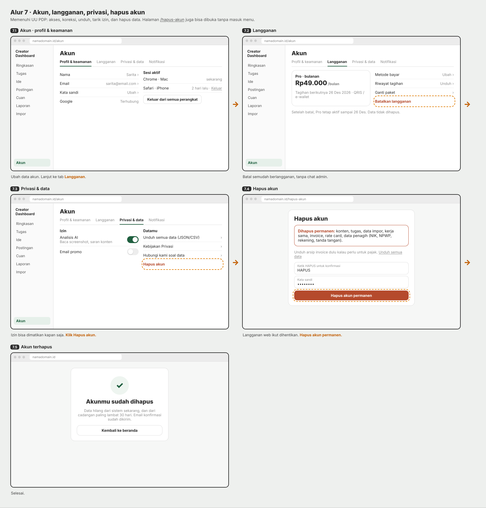
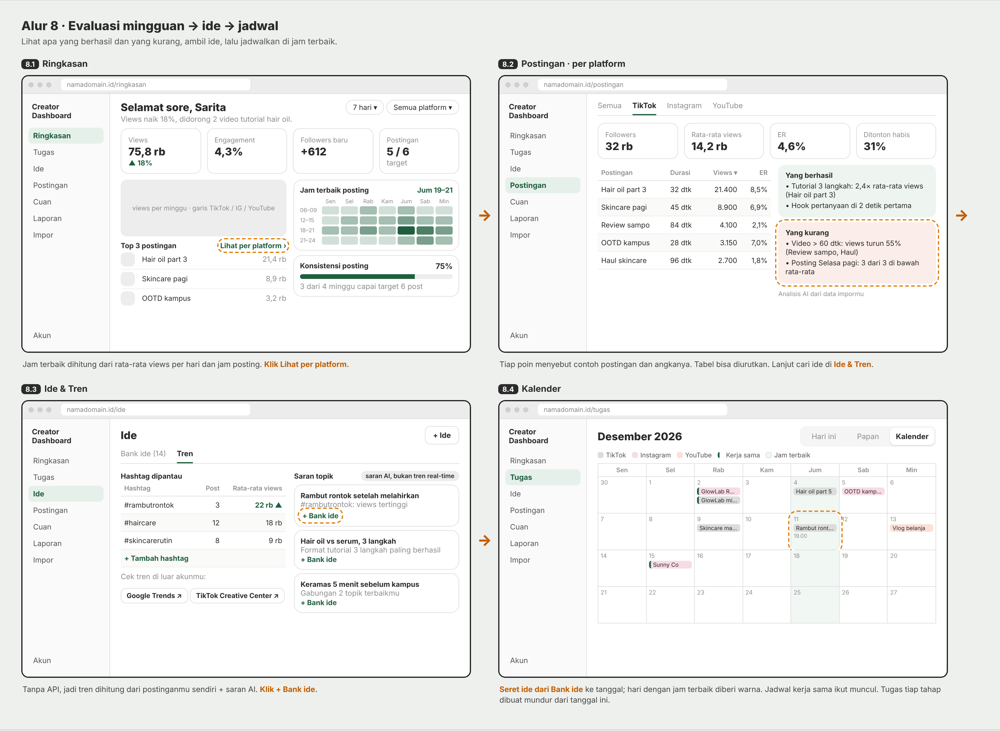

# Wireframe alur (website)

Low-fidelity, 8 alur, 40 layar. Sumber: [flow.html](flow.html), buka di
browser.

Ini **website** yang dibuka di browser (desktop dulu; di HP lewat browser
yang sama), bukan aplikasi toko. Khusus kreator: brand tidak pernah membuka
website ini. Invoice dan rate card diunduh lalu dikirim sendiri oleh kreator.

Garis oranye = yang diklik; teks di bawah layar = aksi berikutnya.

| Gambar | Alur |
|---|---|
|  | 1 · Daftar → onboarding → Ringkasan |
|  | 2 · Impor data mingguan |
|  | 3 · Konten yang berhasil → konten baru → terbit |
|  | 4 · Kerja sama → data penagih & tanda tangan → invoice + pajak → unduh PDF → lunas → arsip |
|  | 5 · Rate card: isi manual atau hitung otomatis → paket → unduh PDF/PNG |
|  | 6 · Masuk dan lupa kata sandi |
|  | 7 · Akun, langganan, privasi, hapus akun |
|  | 8 · Ringkasan (jam terbaik, konsistensi) → per platform (berhasil / kurang) → Ide & Tren → Kalender |

Syarat privasi yang dipenuhi tiap layar ada di
[docs/akun-privasi.md](../docs/akun-privasi.md).

Belum ada: Laporan, Notifikasi, dan tampilan kosong.
