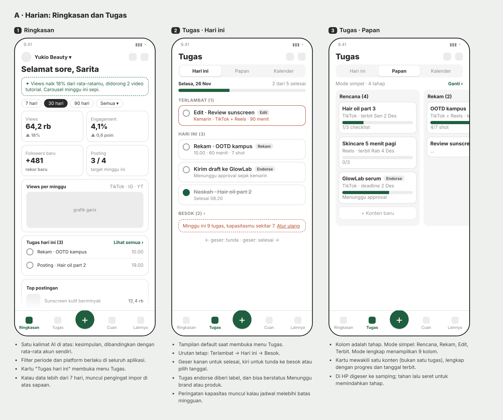
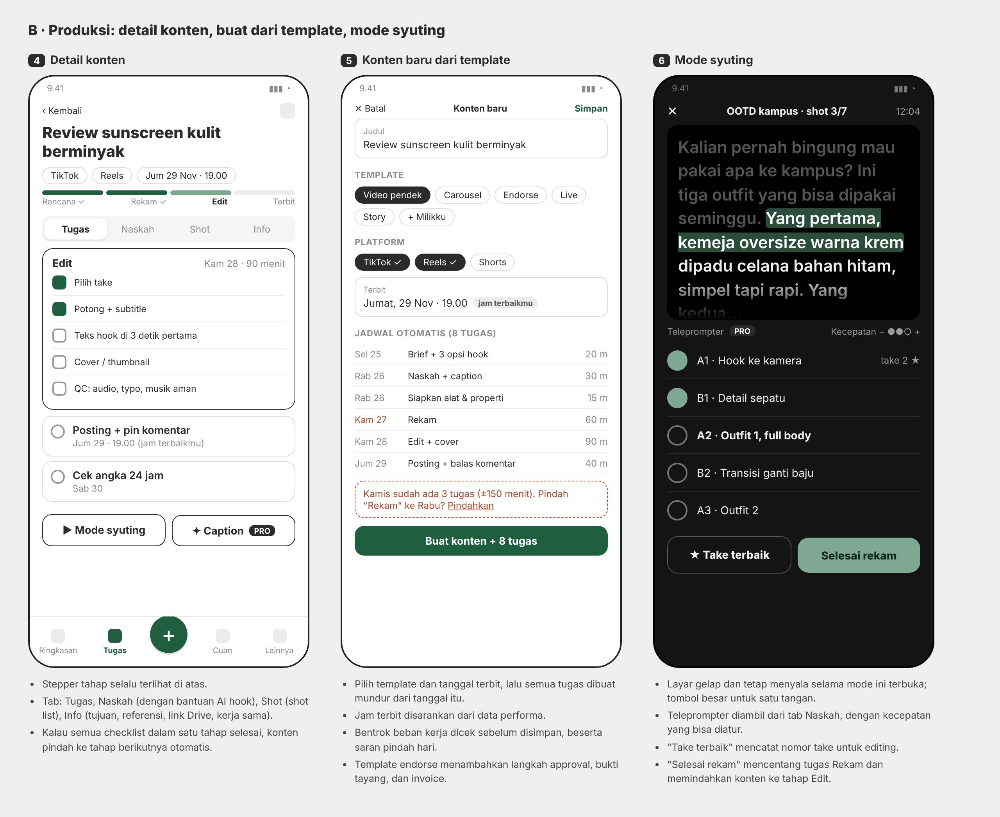
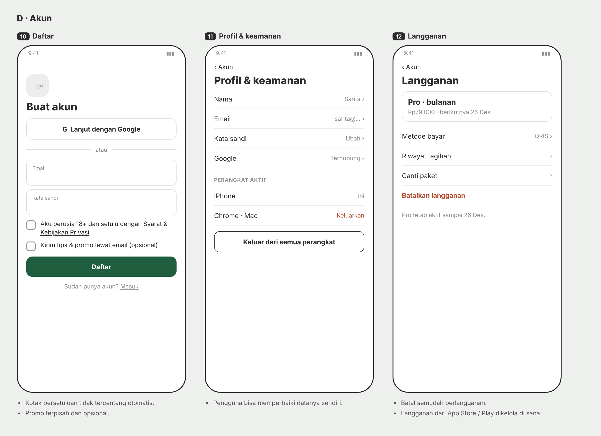
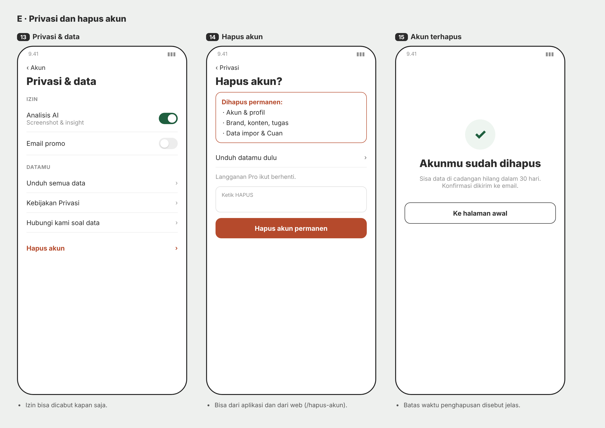
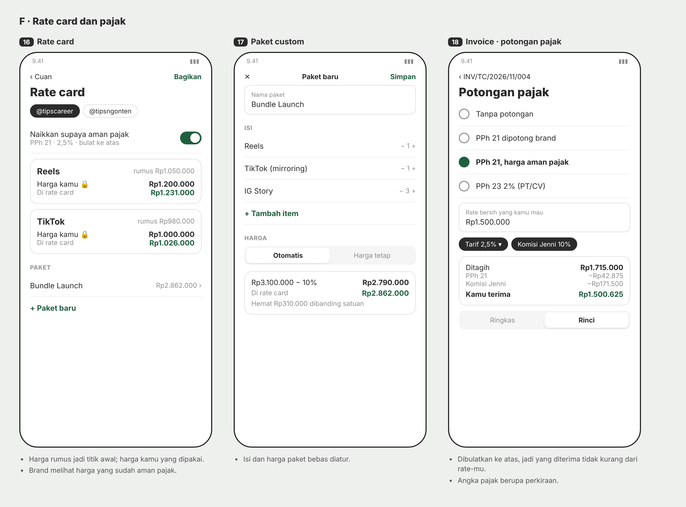
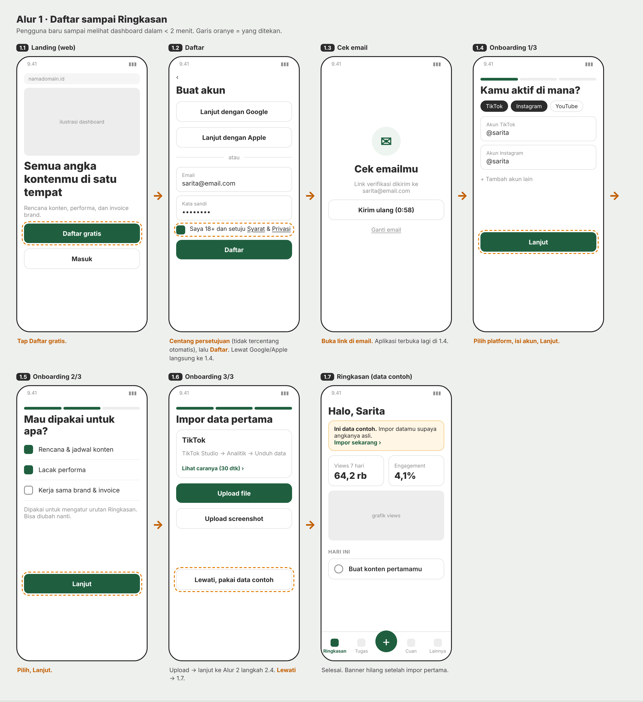
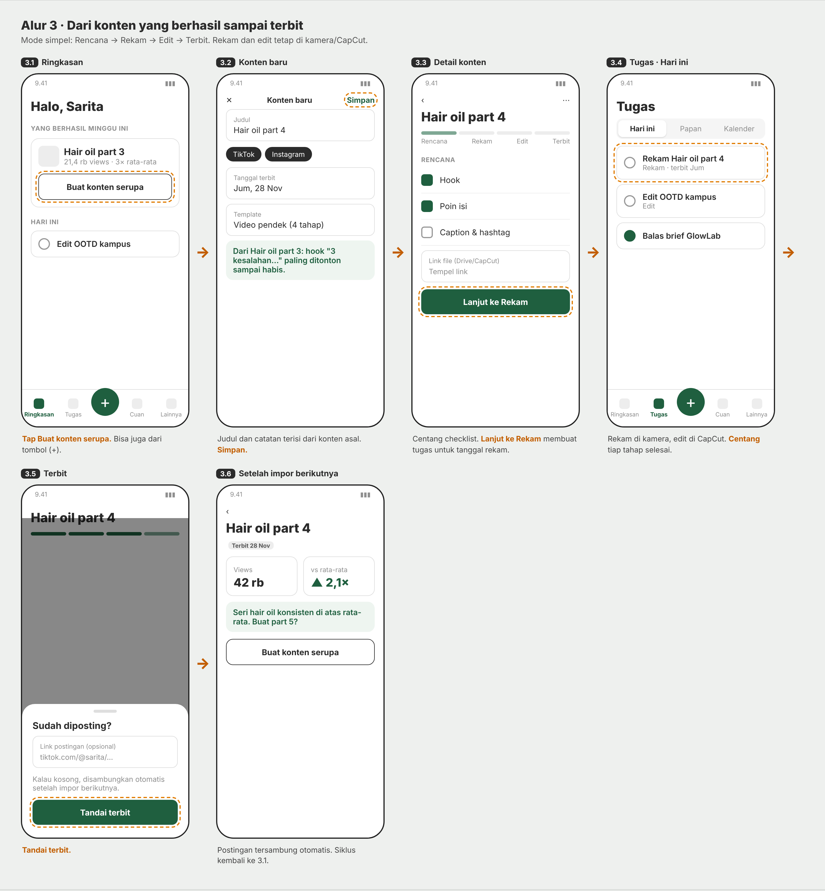
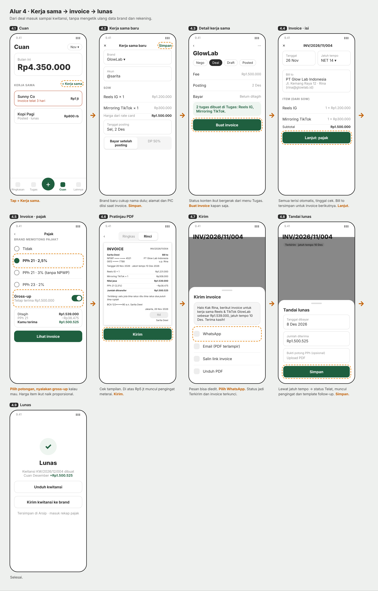

# Wireframe HP (v0.2)

Low-fidelity, 18 layar. Sumber: [index.html](index.html), buka di browser.

Prinsip v0.2: satu tujuan per layar, label pendek, detail dipindah ke
halaman berikutnya.

Keputusan yang dipakai:
- **Tugas** jadi menu sendiri; bar bawah HP: Ringkasan · Tugas · (+) · Cuan · Lainnya.
- Pengguna baru memakai **mode simpel** (Rencana → Rekam → Edit → Terbit).
- **Tidak ada mode syuting.** Rekam dan edit tetap di kamera dan CapCut; di
  sini cukup checklist dan link file.

| Gambar | Layar |
|---|---|
|  | 1 Ringkasan · 2 Tugas, Hari ini · 3 Tugas, Papan |
|  | 4 Detail konten · 5 Konten baru · 6 Tombol (+) |
|  | 7 Pratinjau impor · 8 Cuan · 9 Lainnya / Akun |
|  | 10 Daftar · 11 Profil & keamanan · 12 Langganan |
|  | 13 Privasi & data · 14 Hapus akun · 15 Akun terhapus |
|  | 16 Rate card · 17 Paket custom · 18 Invoice, pajak |

Syarat privasi dan toko aplikasi yang dipenuhi tiap layar ada di
[docs/akun-privasi.md](../docs/akun-privasi.md).

## Alur

Sumber: [flow.html](flow.html). Garis oranye = yang ditekan; keterangan di
bawah tiap layar = aksi berikutnya.

| Gambar | Alur |
|---|---|
|  | 1 · Daftar → onboarding → Ringkasan (7 layar) |
|  | 2 · Impor data mingguan (5 layar) |
|  | 3 · Konten yang berhasil → konten baru → terbit (6 layar) |
|  | 4 · Kerja sama → invoice → kirim → lunas → kwitansi (9 layar) |
|  | 5 · Rate card → link ke brand → tawaran masuk (4 layar) |
|  | 6 · Masuk dan lupa kata sandi (4 layar) |

Hapus akun: layar 13 → 14 → 15 di atas.

Belum ada: versi desktop, Ide, Postingan, Laporan, notifikasi, dan
tampilan kosong.
